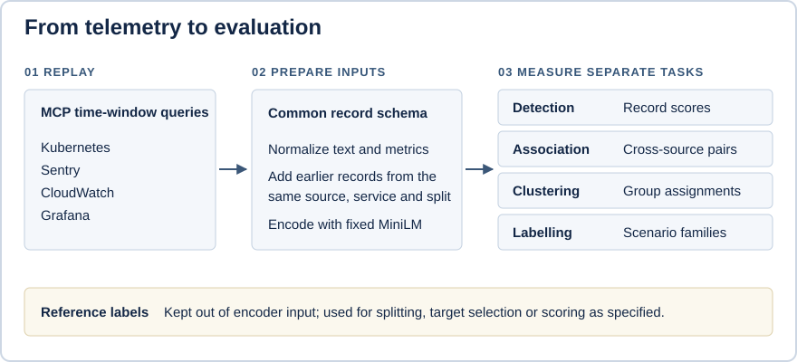
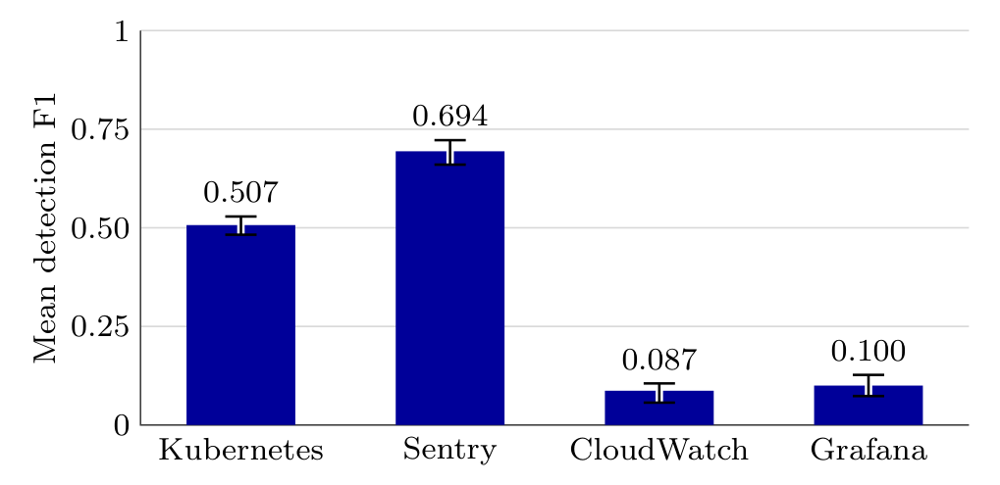
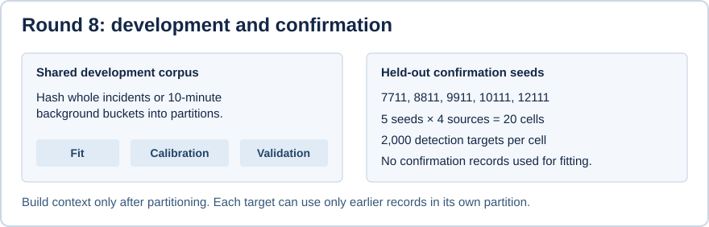
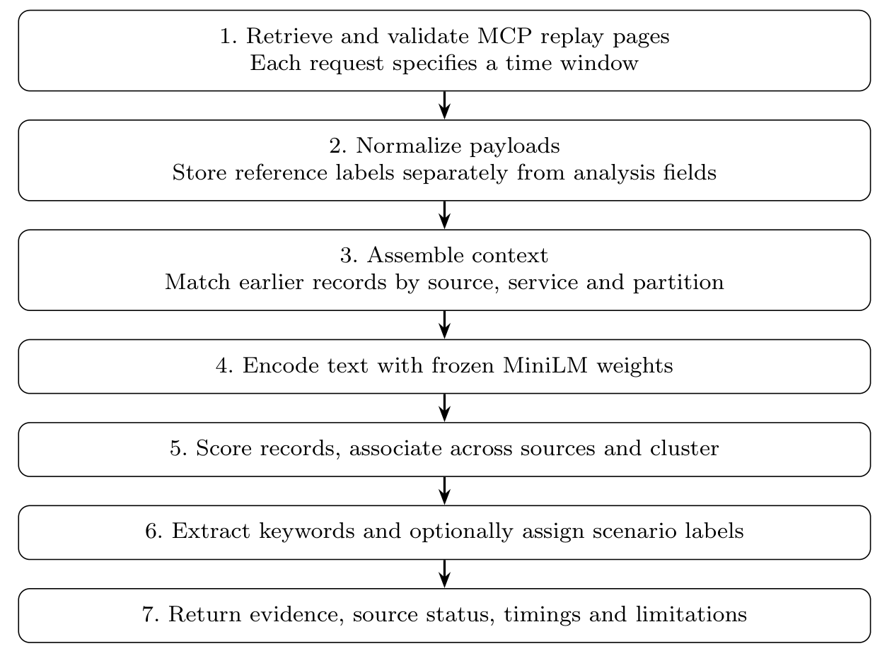

# MOZAIC

*Protocol-Based Telemetry Replay and Task-Separated Incident Analysis* · Companion repository for the Computing revision.

MOZAIC replays telemetry from Kubernetes, Sentry, CloudWatch and Grafana through the Model Context Protocol. It scores unusual records, links records across sources and clusters them. Each task is evaluated separately.



## Check the results

```sh
python3 evidence/verify_aggregates.py
```

Run from the repository root with Python 3.9 or newer. No packages, downloads or credentials are needed. The checker recomputes association metrics from the released counts and checks the evidence files against their recorded hashes. It does not rerun the experiments.

[Find the data behind each table](evidence/README.md) · [Run the fixture tests](runtime/REPRODUCIBILITY.md) · [Trace the code to its source](runtime/SOURCE_PROVENANCE.json)

## What the experiments found

| Manuscript result | What to look at |
| --- | --- |
| **Detection varied by source.** Across five Round 8 seeds, mean F1 was 0.507 for Kubernetes, 0.694 for Sentry, 0.087 for CloudWatch and 0.100 for Grafana. | [Figure 2](assets/figure-2-detection-f1.png) · [Table 5 data](evidence/data/round8_quiet_detection_summary.csv) |
| **Association depended on identifiers.** Mean pair F1 fell from 0.557 to 0.016 when all correlation identifiers were removed. Among 95 selected negative pairs, false co-memberships rose from zero to four. | [Figure 3](assets/figure-3-identifier-stress.png) · [Table 6 counts](evidence/data/round8_background_pair_counts.csv) · [Table 7 counts](evidence/data/round8_overlap_counts.csv) |


*Figure 3 from the manuscript. The lower panel shows a selected cohort, not the global false-positive rate.*

<details>
<summary>Figure 2: detection F1 by source</summary>



</details>

## Round 8 data splits



[Confirmation counts](evidence/data/round8_confirmation_inventory.csv) · [Development counts](evidence/data/round8_shared_dev_cohorts.csv)

## Replay workflow



*Figure 1 from the manuscript. Reference labels stay outside the encoder input. The encoder is fixed, but the detector is fitted and calibrated.*

## What is available

- [Runtime code and fixture tests](runtime/REPRODUCIBILITY.md), with [source hashes](runtime/SOURCE_PROVENANCE.json) and frozen configurations.
- [Aggregate evidence](evidence/README.md), with [original source references and file hashes](evidence/aggregate_manifest.json).
- [Manuscript figures and their provenance](assets/README.md).

This snapshot omits private telemetry, complete row-level predictions and memberships, and paid-provider checkpoints. It does not reproduce every historical run. The four-source collection check stopped at offline initialization; it did not measure detection accuracy.
