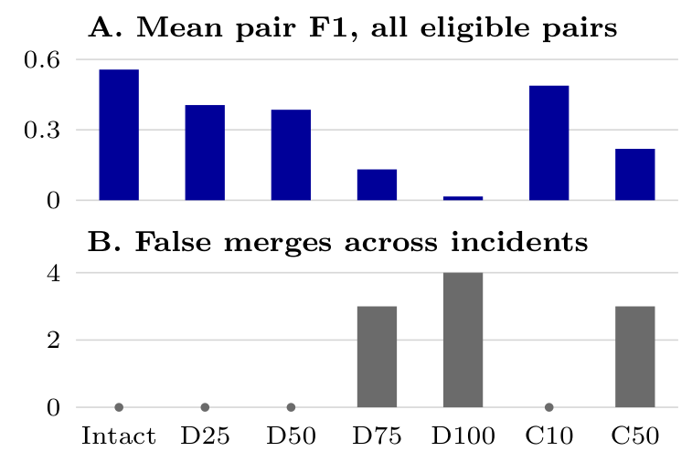

# MOZAIC

**Protocol-Based Telemetry Replay and Task-Separated Incident Analysis**

Code and evidence for the MOZAIC revision for *Computing*. MOZAIC replays Kubernetes, Sentry, CloudWatch and Grafana telemetry through the Model Context Protocol (MCP). It evaluates detection, association, clustering and optional scenario labelling separately.

[Workflow](#replay-workflow) · [Results](#results-from-the-manuscript) · [Run the checks](#run-the-checks) · [Provenance](#provenance-and-scope)

## Replay workflow


**Figure 1, manuscript p. 6.** Reference labels are kept separate from analysis inputs. Context uses earlier records from the same source, service and partition. The encoder weights are fixed; the detector still needs fitting and calibration.

## Results from the manuscript

### Detection varies by source


**Figure 2, manuscript p. 13.** Mean detection F1 and archived 95% bootstrap intervals for five synthetic Round 8 runs under the historical quiet-baseline protocol. These are not production scores. [Source-level summary](evidence/data/round8_quiet_detection_summary.csv)

### Association depends on identifiers



**Figure 3, manuscript p. 15.** With the same records and reference labels, mean pair F1 fell from **0.557** with identifiers intact to **0.016** with full dropout. The bottom panel counts false co-memberships in a selected cohort of 95 negative pairs. It is not the global false-positive rate. [Global counts](evidence/data/round8_background_pair_counts.csv) · [Selected-pair counts](evidence/data/round8_overlap_counts.csv)

## Run the checks

**Verify the aggregate evidence.** Python 3.9+; no extra dependencies, credentials or data downloads.

```sh
python3 evidence/verify_aggregates.py
```

**Exercise the runtime on synthetic fixtures.** Use Python 3.11 or 3.12.

```sh
cd runtime
python3 -m venv .venv
source .venv/bin/activate
python -m pip install -r requirements-smoke.txt
python -m pytest -q
```

The release check passed 38 fixture tests. The optional [four-source replay example](runtime/REPRODUCIBILITY.md) runs in process, with invented records and no cloud accounts. Neither check runs the historical experiments or calls a model provider.

## Provenance and scope

| Looking for | Start here |
| --- | --- |
| A manuscript result and its supporting file | [Evidence guide](evidence/README.md) |
| Source commits, experiment cohorts and file hashes | [Aggregate manifest](evidence/aggregate_manifest.json) |
| Original file hashes, extracted code and frozen settings | [Runtime provenance](runtime/SOURCE_PROVENANCE.json) |
| Origin of the three figures | [Figure notes](assets/README.md) |

This public snapshot does not include the development history, original submission data, private telemetry, complete predictions or memberships, or paid-provider checkpoints. The evidence checker verifies the included aggregate counts and selected calculations, not every underlying experiment.

HDFS and BGL are sampled single-source detection benchmarks. RCAEval labels indicate exposure to a fault injection, not independent record-level anomaly truth. Round 9 rescored saved assignments without refitting or reclustering. The later four-source collection check reached offline initialization and did not score records. Archived scenario-label agreement is not a human assessment of diagnosis quality.

**Encoder pin:** `sentence-transformers/all-MiniLM-L6-v2`, revision `c9745ed1d9f207416be6d2e6f8de32d1f16199bf`.

When referencing the repository, cite the manuscript title and the exact Git commit you used.
