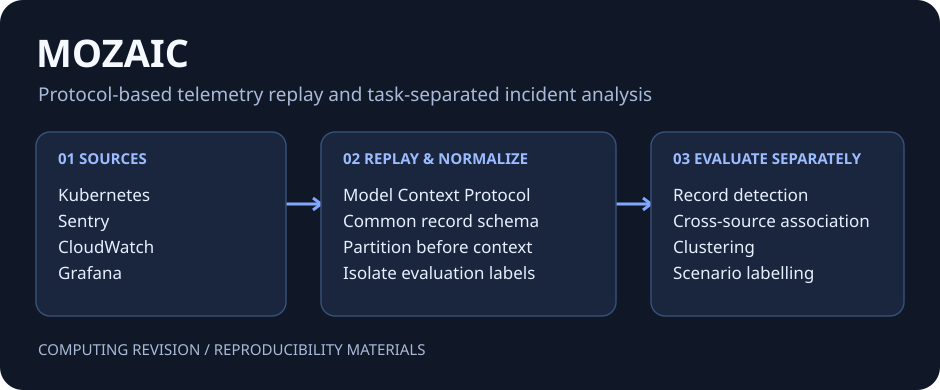
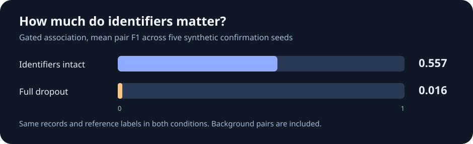

# MOZAIC

**Protocol-based telemetry replay and task-separated incident analysis**



This repository accompanies the revised manuscript for *Computing*. It contains the replay and analysis code, selected experiment configurations, and aggregate evidence for checking reported results. MOZAIC keeps record detection, cross-source association, clustering and optional language-model labelling separate so that a result from one task does not stand in for another.

## Start here

**Check the paper's aggregate evidence first.** This takes Python 3.9+ and no extra packages or credentials:

```sh
python3 evidence/verify_aggregates.py
```

For the code smoke test, use Python 3.11:

```sh
cd runtime
python3 -m venv .venv
source .venv/bin/activate
python -m pip install -r requirements-smoke.txt
python -m pytest -q
```

The smoke tests use generated fixtures, not the paper's measurement data. They do not download MiniLM or call a model provider. The release check passed 38 fixture tests. For the optional four-source in-process replay example, see [runtime instructions](runtime/REPRODUCIBILITY.md).

| Directory | Start with |
| --- | --- |
| [Runtime](runtime/) | Replay adapters, shared schema, fitted detector, association, clustering and tests. [Source provenance](runtime/SOURCE_PROVENANCE.json) identifies the archived code and any adaptations. |
| [Evidence](evidence/) | [Table-to-artifact guide](evidence/README.md), aggregates and an offline checker. |

The original semantic encoder was `sentence-transformers/all-MiniLM-L6-v2` at revision `c9745ed1d9f207416be6d2e6f8de32d1f16199bf`.

## One result from the paper



The chart uses five Round 8 synthetic confirmation seeds. Both conditions keep the same records and reference labels, with background records included. The values measure whether pairs land in the same predicted group, not whether the system identifies a root cause.

## What the evaluation establishes

| Evaluation | Scope |
| --- | --- |
| HDFS and BGL | Sampled single-source detection benchmarks. No cross-source association claim. |
| Round 8 | Synthetic confirmation runs. Tests detection, identifier stress and selected clustering conditions. |
| Round 9 | Re-scores saved assignments. No new detector fitting or clustering rerun. |
| RCAEval | Case-disjoint temporal exposure check on logs, metrics and traces. Exposure labels are not independent record-level anomaly labels. |
| Four-source collection check | 40 observations across Kubernetes, Grafana, Sentry and CloudWatch supported offline initialization. No scoring or grouping was run in this check. |
| Archived labelling runs | JSON parsing, schema validity and scenario-family agreement are distinct checks. Free-text usefulness and diagnosis were not human-rated. |

## Reproducibility boundary

The included code and aggregate checks do not replace the full experiment archive. This release does not include the original submission data, private telemetry, credentials, paid provider checkpoints, or complete row-level predictions and memberships. It cannot independently recreate every reported number or establish production incident diagnosis. The detector requires fitting and calibration even though the encoder weights are fixed.

## Citation

If citing this material in the review, cite *MOZAIC: Protocol-Based Telemetry Replay and Task-Separated Incident Analysis* and the commit of this repository you used.
